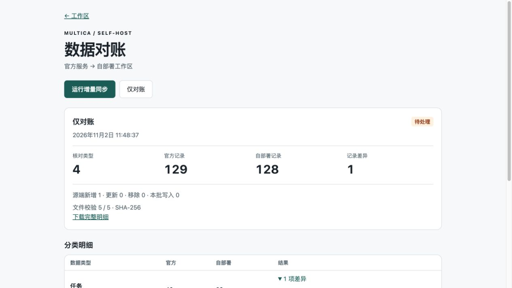

# Run incremental migrations from workspace settings

The rehearsal host runs a browser console and a separate worker. A workspace owner or administrator can open **Settings → Data reconciliation** and choose **Run incremental sync** or **Compare only**. The direct browser URL is `/<workspace-slug>/reconciliation`. The browser can be closed after submission. The queue, worker and reports live on the host.

The worker reads the official API with a dedicated source PAT. It enumerates current resources on every pass. For completed runs it uses the
official task-message `since` cursor and rechecks the last cached message against
the API. Changed or missing anchors and message sequences with gaps trigger a
full read. New and active runs are read in full. Compare-only runs independently
read all source transcripts. Cached prefixes are bound to the source, user and
workspace and verified by checksum. It compares primary keys and fields with the last committed plan, downloads missing or damaged cached attachments and writes only added or changed rows. A comparison performs a fresh source and target read without applying a data import.

Runs record the source additions, updates and removals, actual database writes, per-table counts, missing or extra keys, changed fields, snapshot blockers and independent target file hashes. Current runs defer nonterminal task history until a subsequent pass. Target-only records and source deletions appear in the report for review. History and the downloadable JSON report require the same permission as the page.

Example with synthetic data and one missing target record.

## Provision a dedicated rehearsal stack

1. Complete the initial import and API readback in [the migration guide](../README.md). Use an offline, single-workspace target. The incremental worker locks the affected tables and refuses to apply changes after a target runtime connects or a nonterminal target task appears.
2. On the self-host server install Python 3.11+, Docker and systemd. Copy this checkout's `scripts/cloud_sync*.py` and `deploy/migration/console/` with their repository-relative layout. The web process runs as an unprivileged system user and delegates session validation to the existing Multica API. Only the worker has access to Docker and the two PATs.
3. Prepare `/etc/multica-reconcile/web.json` (0644) and `worker.json` (0600) using the examples in this directory. Set the actual workspace UUID, slug, public origin, loopback backend port, dedicated Compose project, database user and database name. Use the same absolute SQLite path in both configs.
4. In the worker's private directory (0700), put `source.json` and `target.json` (0600). Both have the shape `{"server_url":"...","token":"..."}`. Create a separate expiring personal token under API Tokens on each service. Use the public HTTPS Cloud API and the target's loopback HTTP API. Multica PATs are account credentials. The source exporter uses GET. Record expiration with the operator and replace these files before expiry.
5. Copy the schema used for the original plan to `schema.json`, the **applied** plan to `baselines/00000000-0000-0000-0000-000000000000.json`, and the target avatar signing key to `avatar.key`. Keep them private. Optionally seed `assets/` with the verified source manifest and files. The worker checks hashes before reuse. To display a historical import, supply `initial-report.json` with `workspace_id`, an ISO `created` timestamp, `state`, and the original verified `report`. Omit this file when there is no verified historical report.
6. As root run `sh deploy/migration/console/install.sh`. Install the console location from `nginx.conf.example` inside the dedicated vhost, run `nginx -t`, and reload. Only loopback port 18083 serves the console. The public URL uses the existing TLS vhost.
7. Build the web image with the settings-link changes on the application's deployed release. Pin its digest in `SYNC_WEB_IMAGE`, set `MULTICA_MIGRATION_WORKSPACE_SLUG` in the private Compose environment, and recreate only the frontend using the migration overlay. The standalone management URL also works with the stock web image.
8. Verify a fresh browser is sent to login, a member is denied access, and an owner can submit a run. Check the completed report and file verification before switching clients.

## Recovery and cutover

One queued or running job is allowed at a time. Each incremental write first runs in a rollback transaction. A private `pg_dump -Fc` backup precedes commit. The target stores the active plan ID in `migration_control.baseline` within the import transaction. The corresponding file is persisted before commit, so restarting the worker cannot select an unapplied plan as its baseline. Target edits conflicting with Cloud changes abort the batch. Source and target API credentials belong to the worker account's operator and are never returned to the browser.

The UI retains run history in its SQLite database. The private directory retains the active baseline, initial baseline and recent recovery points. A failed or interrupted run can be resubmitted. A failure after commit requires another readback. Pending usage aggregate work is retried by the next sync. Inspect the root-only `worker.log` for detailed diagnostics. Back up the active baseline with the corresponding target database and file volume.

When the final fresh readback matches, finish the active job and disable the worker and web units before reconnecting runtimes for cutover. Revoke the two dedicated migration PATs in their respective services. The user's normal login and Cloud desktop credentials are independent.
